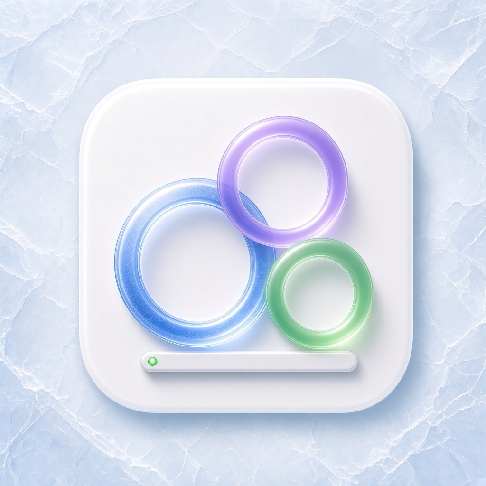
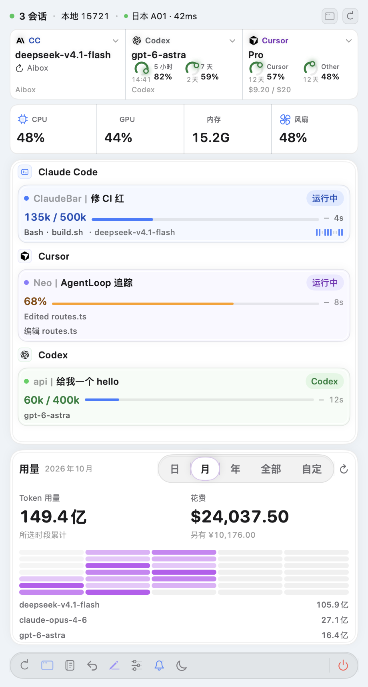
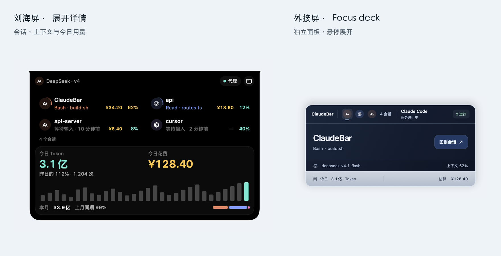
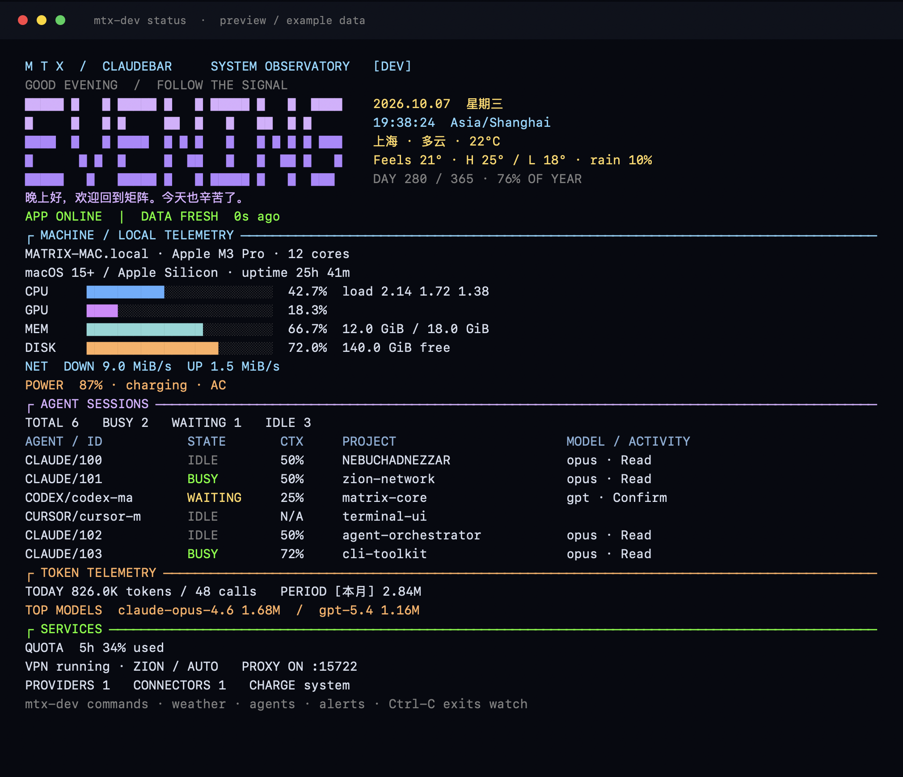

**[English](README.en.md)** · **中文**

<p align="center">
  
</p>

<h1 align="center">ClaudeBar</h1>

<p align="center">
  Claude Code、Codex 与 Cursor 的 macOS 工作台。<br>
  切换模型，跟踪会话，查看用量与请求。
</p>

<p align="center">
  <a href="https://github.com/wangxiajun68/ClaudeBar/actions/workflows/ci.yml"></a>
  <a href="https://github.com/wangxiajun68/ClaudeBar/releases/latest"></a>
  
  
  
</p>

<p align="center">
  <a href="https://github.com/wangxiajun68/ClaudeBar/releases/latest"><strong>下载 macOS 版</strong></a>
</p>

https://github.com/user-attachments/assets/1aef4455-aa53-42d1-a1a7-63cdc3926551

<p align="center">
  <a href="docs/promo/claudebar.mp4">下载高清原片（1080p · 52 秒）</a>
</p>

---

ClaudeBar 把 Claude Code、Codex 和 Cursor 的状态放在一起：菜单栏里查看模型和额度，灵动岛跟进 Agent，桌面窗口查看会话、用量和请求详情。应用使用 SwiftUI 与 AppKit 构建，支持 macOS 15+、Apple Silicon。

## 安装

从 [Releases](https://github.com/wangxiajun68/ClaudeBar/releases/latest) 下载 DMG，将 ClaudeBar 拖入「应用程序」后启动。首次使用在模型页添加供应商，其他功能按需开启。安装拦截与权限问题见 [FAQ](docs/FAQ.md)。

Claude Code 与 Codex 的模型配置独立管理；切换后请新开终端会话。Cursor 集成提供会话、用量和额度读取。

## 界面

### 菜单栏 Popup

查看当前模型、官方额度和正在运行的会话，也能切换模型与打开桌面页。

<p><a href="docs/promo/popup.png"></a></p>

### 灵动岛

在屏幕顶部查看 Agent 状态、完成提醒和会话详情。支持多显示器：刘海屏沿硬件轮廓展开，普通屏幕使用独立的 Focus deck。

[](docs/promo/island.png)

### 桌面窗口

概览包含天气、系统负载、能源流向和活跃会话。会话页集中查看工具活动、上下文及累计 Token / 费用；迁移工作台可将受支持的历史创建为目标客户端的新会话。

[](docs/promo/overview.png)

[](docs/promo/sessions.png)

> 视频与示例图使用当前生产视图及固定演示数据制作；空间分层和镜头是宣传编排。模型、额度、费用不代表真实账户。

## 主要功能

| 功能 | 可以做什么 |
| --- | --- |
| 模型与供应商 | 分别管理 Claude Code / Codex 配置；导入供应商、切换模型、查询可用模型和能力。 |
| 自动模型网关 | 将模型加入 Auto 池，按任务档位与能力路由；管理供应商并发、排队、RPM / 估算 TPM 和备用尝试，查看路由关系与请求航道。 |
| 会话与迁移 | 查看 Claude Code、Codex、Cursor 状态与工具活动，返回客户端继续工作；在迁移工作台选择来源、目标和历史预览。支持范围见[迁移契约](docs/technical/session-migration.md)。 |
| 用量与费用 | 按时间、来源和模型分析 Token，查看活动热图；费用估算与 Cursor 实际扣费分别显示，缺失值不当作零。 |
| 请求检查 | 本地 API 代理提供 Chat / Responses / Anthropic 接入；启用报文记录后检查对话、工具调用、图片与原始数据。 |
| VPN | 内置 mihomo，管理订阅、节点、系统代理与 TUN；查看代理 / 直连历史流量，配置域名规则。 |
| 连接器与文档 | 查看 Skills、MCP、插件与共享 CLI，执行支持的启停操作；在工作台中阅读和编辑飞书文档。 |
| Mac 与桌面 | 天气与问候、CPU / GPU、内存、磁盘、风扇和电池读数；支持机型的充电上限、截图和悬浮木鱼。 |
| Matrix CLI | 使用 `mtx` 查看资源、会话、用量和配置，执行支持的模型 / VPN / 连接器操作；性能模式可保留后台与 CLI、释放前端。 |

[](docs/promo/gateway.png)

### 本地 API

启用本地代理后，客户端使用 `http://127.0.0.1:15721/v1`（端口可改），每次请求携带本机令牌。模型 `auto` 交给自动网关选择；请求已开始输出后不自动重试。

记录正文需要单独开启：Claude Code / Codex 在供应商上启用「记录请求报文」，其他客户端使用设置中的「记录第三方流量」。完整说明见[模型网关](docs/LLM_GATEWAY.md)。⌘K 可跳转页面、模型和会话。

### 终端



```bash
mtx sessions count
mtx system --json
mtx -w 1
mtx mode performance
mtx mode desktop
```

CLI 随应用构建，命令安装需显式执行；开发版使用 `mtx-dev`，保留系统集成限制。安装和完整命令见 [CLI 使用说明](docs/CLI.md)。

## 数据与权限

ClaudeBar 从本机客户端文件读取会话和用量。模型切换与部分连接器操作会更新对应客户端配置；系统功能按需授权。

| 来源 | 路径或行为 |
| --- | --- |
| Claude Code | 读取 `~/.claude/`；模型切换更新 `~/.claude/settings.json`。 |
| Codex | 读取 `~/.codex/`；模型切换更新 `~/.codex/config.toml`。 |
| Cursor | 读取项目记录和 `state.vscdb`；额度、账单通过 Cursor 接口获取。 |
| ClaudeBar | 正式版数据位于 `~/Library/Application Support/ClaudeBar/`；请求日志和 VPN 文件分别位于 `logs/`、`vpn/`。 |

模型推理由配置的上游完成；天气、额度、文档和订阅会访问对应服务。连接器清单扫描不启动 MCP，打开 MCP 详情会连接服务并读取工具列表，不调用工具。代理记录可能包含对话正文，启用前请确认记录范围。

费用按 Token 与刊例价估算，不是实际账单；Cursor 实际扣费独立显示。人民币与美元默认分列，主动选择换算时才使用显式汇率，缺失汇率时回到分列。

## 开发

需要 macOS、Xcode Command Line Tools 和 Python 3。日常开发使用 `dev` 分支与隔离的 ClaudeBar Dev；正式版的配置和运行实例保持独立。

```bash
git clone https://github.com/wangxiajun68/ClaudeBar.git
cd ClaudeBar
git switch dev
make setup
make build
```

| 命令 | 结果 |
| --- | --- |
| `make build` | 编译 `.build/dev/ClaudeBar Dev.app`，不安装或启动。 |
| `make run` | 构建并启动开发版。 |
| `make test-fast` / `make test TEST=core` | 快速回归 / 单组验证。 |
| `make test` | 全部回归，不启动应用或真实系统集成。 |
| `make release` | 编译正式版，不安装。 |
| `make package` | 生成 DMG、zip 与 SHA-256。 |

[开发指南](docs/DEVELOPMENT.md) · [构建与签名](docs/technical/07-build-and-signing.md) · [发布流程](docs/RELEASING.md)

视频的分镜和重建方法见[制作说明](docs/promo/prompt.md)。运行 `python3 Tools/serve-promo.py` 后访问 `http://127.0.0.1:8808/docs/promo/film.html`，可按章节播放。

## 文档与贡献

[文档索引](docs/README.md) · [FAQ](docs/FAQ.md) · [更新日志](docs/CHANGELOG.md) · [贡献指南](CONTRIBUTING.md) · [安全报告](SECURITY.md)

报告问题时请附系统版本、应用版本和复现步骤；日志中移除密钥、账号及私人对话。未来架构与品牌研究收录于[调研目录](docs/reviews/README.md)，不代表本版本已完成 Rust 迁移或更名。

## 许可证

代码采用 [MIT](LICENSE)。Lucide 图标采用 [ISC](Sources/Licenses/Lucide.txt)，字体及其他素材见[素材声明](Sources/ClaudeBar/Resources/ASSET-LICENSES.md)，VPN 内核见 [mihomo 说明](vendor/mihomo/README.md)。
